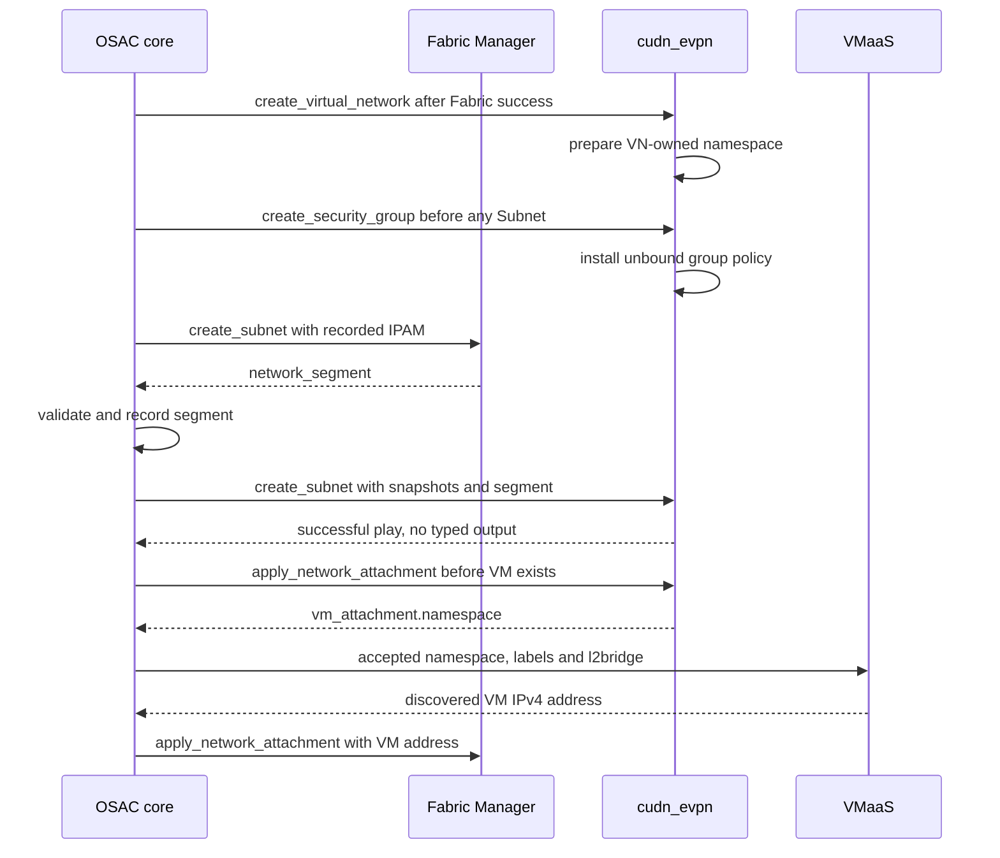

# CUDN EVPN Kubernetes Manager: VM-to-Fabric Networking

## Summary

OSAC's `cudn_evpn` Kubernetes Manager realizes a primary Layer2 EVPN ClusterUserDefinedNetwork (CUDN), using the Fabric segment and recorded address plan supplied through the approved manager contract. It prepares VM policy and a tenant namespace before VM creation, with one owner Subnet per VirtualNetwork under the current platform limit. See [PRD](prd.md) for detailed requirements.

This is the OSAC-6758 documentation alignment draft under [OSAC-6757](https://redhat.atlassian.net/browse/OSAC-6757). [PR #357](https://github.com/osac-project/enhancement-proposals/pull/357), merged as `a430f35da98461b5331f690332b1eebd3a3012b5`, defines the approved baseline. This revision includes the user-requested [RT fix in osac PR #1971](https://github.com/osac-project/osac/pull/1971) as a proposed exception to its route-target clauses; shared-contract approval is still required. It records the manager delta, unresolved realization choices and required validation, without asserting completed implementation or a passed EVPN Fabric pair. The implementation baseline is OSAC main `38057b862f2d86e4dab53a386d5be9371bbb65ab`; PR #1971's inspected head is `38d18d944035527db02bd95dd903f08b4e9ecedd`.

The user selected one VN-owned workload namespace and one NetworkPolicy per SecurityGroup (D26). This proposal replaces the baseline's manager-specific VN no-op with namespace creation/deletion and retains that namespace across owner Subnet deletion. Shared-contract review remains required; this selection does not resolve the remaining concurrency/deletion evidence gates. [User]

The supporting [route-target amendment](route-target-amendment.md) states the exact proposed shared-contract edits. The [write-protection review](write-protection-review.md) gives concrete policy predicates and the remaining already-issued-create race. Its evaluated coordinator is insufficient on its own and is not selected for implementation by this document.

## Motivation

The existing role creates and deletes a CUDN from legacy Fabric outputs. The approved networking model additionally requires minimal snapshots with stable API IDs, recorded IPAM, independent SecurityGroup tasks, namespace-first VM attachment and typed results. These boundaries let a compatible Fabric Manager supply a segment without manager-specific OSAC orchestration.

The [manager integration contract](/enhancements/OSAC-1433-network-manager-integration-contract-networking/design.md) owns the task interface. [Unified Networking](/enhancements/OSAC-1433-unified-networking/design.md) owns resource meaning and allocation; [VMaaS](/enhancements/OSAC-1435-vmaas-networking/design.md) owns the VM lifecycle. This document describes the Kubernetes Manager's responsibilities within those contracts.

### Goals

- Extend the existing role to implement the eight internal tasks with the prescribed snapshots, typed outputs and error classification.
- Consume recorded gateway, address pools and Fabric segment without independently allocating or reshaping them.
- Establish primary-network policy and deterministic namespace preparation before VM creation.
- Preserve stable API-ID ownership, idempotency and safe cleanup while enforcing the owner-Subnet limit.
- Identify the supported platform mechanisms and real-pair evidence required before claiming the target is available.

### Non-Goals

- New networking APIs, generic provider-written Kubernetes Managers, network types beyond `evpn`, and another shared-core dispatcher.
- Multiple networking hubs, secondary VM tenant attachments, IPv6, dual-stack and disconnected networking.
- Inter-VirtualNetwork peering, migration/adoption of existing Fabric state, and alternate gateway topologies.
- Tenant-task automation of underlay peering/VTEPs or creation of MetalLB pools for CaaS ingress.

## Proposal

`cudn_evpn` is an OSAC-shipped Ansible role with network type `evpn`. The Fabric Manager owns physical networking, its IP-VRF/MAC-VRF, the anycast gateway and physical DHCP. The Kubernetes Manager owns the hub overlay network, overlay DHCP, VM pod policy, and its namespaces/bindings. The release supports one provider-owned networking hub; tasks reach it through the job service account.

Core records manager identities, immutable address layouts and accepted typed segments, orders the tasks and validates their outputs. Shared adoption is tracked by [OSAC-6766](https://redhat.atlassian.net/browse/OSAC-6766). Manager code is [OSAC-6761](https://redhat.atlassian.net/browse/OSAC-6761); Fabric realization is [Agentless OSAC-6755](https://redhat.atlassian.net/browse/OSAC-6755) and [Netris OSAC-6756](https://redhat.atlassian.net/browse/OSAC-6756). The current release's manager/type compatibility requirements apply to every pair.

### Workflow Description

#### Installation

1. The Cloud Infrastructure Admin and provider agree the hub AS, per-node BGP addresses, Fabric peers/AS, VTEP CIDR, reserved VNI range and workload DNS resolvers.
2. The administrator installs the required OVN-Kubernetes, FRR-K8s, KubeVirt and node networking prerequisites and configures peering with every hub node. The Fabric routes the VTEP CIDR in the underlay. Adding/removing hub nodes requires corresponding provider peering maintenance.
3. The installer supplies the immutable manager registration and networking instance-group configuration. Core admits networking creation once its readiness gates pass.
4. The administrator verifies the actual hub/Fabric versions and records the supported-pair validation separately from registration success.

#### Network and VM Creation

1. A Tenant Admin or Tenant User creates a VirtualNetwork, Subnet and SecurityGroups through the normal OSAC APIs; tenants supply no VNIs or route targets.
2. Core runs Fabric create before Kubernetes create for the VirtualNetwork, Subnet and groups. In this proposal, Kubernetes VN create prepares the VN namespace, allowing group creation before any Subnet. Fabric `create_subnet` returns a typed segment; core validates and records it before starting dependent Kubernetes work.
3. The manager's first `create_subnet` to claim an unowned VN network records the Subnet API ID, realizes its CUDN and baseline protection, and completes its prerequisite/readiness checks. A non-owner Subnet create succeeds without creating a second hub network.
4. VMaaS creates the overlay NetworkAttachment. Core calls Kubernetes `apply_network_attachment` before the VM exists. The manager checks owner support, validates the shared VN-owned primary-network namespace and baseline, binds policy by the ComputeInstance API ID, and returns only the namespace. Different targets in the same VN share it.
5. VMaaS creates the VM in that namespace, supplies the API-ID pod label and `l2bridge` interface, and discovers its overlay IPv4 address. Core then runs the Fabric overlay bind with that address. Network readiness follows the approved task ordering.
6. A VM request on a non-owner Subnet fails at attachment apply with the explicit permanent implementation-limit message. The other Subnet remains usable for physical attachments; the existing owner's network remains usable.

The sequence shows the namespace/policy gate before VM creation and the Fabric bind after address discovery. The manager never inspects or patches the VM.



#### Deletion

VMaaS removes its VM resources before core runs Fabric attachment delete and then Kubernetes attachment delete. The manager removes only that target's binding membership and per-VM artifacts; the VN namespace and other bindings remain. Core retains finalizers until cleanup succeeds.

After overlay attachments are gone, owner `delete_subnet` removes its network/baseline and releases the claim, retaining the VN-owned namespace and group policies. Other Subnet deletes leave the network alone. There is no sibling handover; a subsequent create can claim after cleanup. Group deletion removes only its policy after no attachment selects it. VN delete removes its namespace after child teardown and reviewed foreign/live-resource protection checks. The proposed VN tasks have namespace side effects and no typed output; they replace PR #357's manager-specific no-op clause. [User]

### API Extensions

This manager alignment adds no tenant API. It consumes the shared-core snapshot, `Subnet.status.ipam`, accepted `status.networkSegment`, NetworkAttachment and typed namespace result defined by PR #357. Source API/CRD changes, status projection, admission, task dispatch and VM consumption belong to OSAC-6766 and its children.

Its internal contract gains the six task files missing from the existing role and replaces legacy inputs on the two Subnet files. If the networking controller is unavailable, dependent attachments do not become ready and VM creation waits; the manager cannot bypass that gate.

## UX Alignment

Tenant VM/network forms continue to use the ordinary Subnet and SecurityGroup references. The manager adds no tenant-facing VNI, RT or peering control. Shared console work must present manager failure, retry and owner-limit diagnostics accurately; the separate UI drafts in OSAC-6766 own that integration. The installation controls and their Enclave handoff are assessed below.

### Implementation Details/Notes/Constraints

#### Fixed Task Interface

Every entry point is `tasks/<task>.yaml` in `osac.templates.cudn_evpn`, invoked by the generic playbook with one `osac_job_vars` value. It includes `{manager: {name, type: kubernetes, ansible_role}, task, tenant, resource}` plus only the task-defined fields. Settings and credentials are environment variables; inputs contain no cluster selector or secrets. [Contract: §§4.3–4.6, 4.10]

| Task pair | Additional input | Required effect | Typed result |
|---|---|---|---|
| create/delete_virtual_network | Resource VN snapshot with spec.ipv4Cidr | Proposed VN-owned shared namespace creation/safe final deletion; shared-contract amendment required | None |
| create/delete_subnet | virtual_network, ipam, network_segment; resource Subnet snapshot with spec.ipv4Cidr | Claim/realize or remove the owner's network and baseline; non-owner implementation-limit behavior | None |
| create/delete_security_group | virtual_network; resource group snapshot with spec.ingressRules/spec.egressRules | One unbound policy per group, conditional atomic rule replacement, or owned policy removal | None |
| apply/delete_network_attachment | target, network_attachment, virtual_network, subnet, ipam, network_segment | Overlay namespace/policy preparation or owned cleanup | Apply only: vm_attachment.namespace |

A snapshot contains `apiVersion`, `kind`, top-level stable API `id`, `metadata: {name, namespace, uid, generation}`, and only the prescribed `spec` fields. Ownership uses `id`; the tenant comes from `osac_job_vars.tenant`, not an assumed snapshot annotation. Attachment `resource.id` equals `target.id`; the target is `{kind: ComputeInstance, id}` and the interface is `overlay`. SecurityGroup references are distinct API IDs in `network_attachment.security_group_ids`. The manager ignores a later `interface.ipv4_address` field added for Fabric binding.

Only apply publishes:

```yaml
osac_result:
  vm_attachment:
    namespace: <prepared-namespace>
```

No-output tasks publish no `osac_result`. Failures publish a sanitized `osac_error: {message: <nonempty-string>, retryable: <boolean>}` when possible and fail the play. No version/profile/identity result wrapper is added. Core associates the result with the launched job and checks the namespace exists with `osac.openshift.io/tenant` equal to the input tenant.

#### Address Plan, Segment and Gateway

The accepted segment has exactly `{type: evpn, l2_vni: <integer>, l3_vni: <integer>}`. Both VNIs are different integers from 1 to 16777215. Core validates cross-resource uniqueness and stores the segment. The approved shared contract also rejects a hub AS above 65535 with a VNI above 65535. This proposal retains that shared admission rule until Q5 settles its disposition; adopting explicit 0:VNI alone does not claim a wider accepted range, and the rule is not described as a property of the 0:VNI encoding.

Core supplies a recorded plan such as:

```yaml
ipam:
  gateway_ipv4: 10.0.1.1
  overlay_ipv4_cidrs: [10.0.1.0/25]
  physical_ipv4_cidrs: [10.0.1.128/26]
  lb_vip_ipv4_cidrs: [10.0.1.192/26]
network_segment:
  type: evpn
  l2_vni: 31
  l3_vni: 32
```

These are allocation pools within the same `10.0.1.0/24` L2 Subnet. The manager reserves all CIDRs outside the overlay pool; in this example the minimal exclusion is `10.0.1.128/25`. Network, broadcast and gateway addresses are never workload allocations. OVN infrastructure addresses come from its overlay range. Empty physical/lbVip lists are valid; the immutable recorded plan is reused for retries and deletion. [Contract: §4.8]

The primary Layer2 CUDN sets `transport: EVPN`, the installed VTEP reference, L2/L3 VNIs, MTU 1500, the full Subnet CIDR, recorded gateway and non-overlay reservations. Fabric supplies the anycast gateway over the MAC-VRF; the network has no OVN router port. It does not create a second gateway or coordinate two gateway MACs. [Contract: §§4.9–4.10]

#### Explicit Route-Target Compatibility Fix

This proposal carries PR #1971's host-side behavior for every network created by `cudn_evpn`, without a Netris or switch-vendor condition:

```yaml
evpn:
  vtep: tenant-vtep  # example installed VTEP
  macVRF:
    vni: 31
    routeTarget: "0:31"
  ipVRF:
    vni: 32
    routeTarget: "0:32"
```

The general rules are `macVRF.routeTarget = "0:<l2_vni>"` and `ipVRF.routeTarget = "0:<l3_vni>"`; each field uses its own supplied VNI. The typed segment remains the current VNI-only shape. PR #1971 does not add API RT retrieval or configure any Fabric device. [User; osac PR #1971; Clarify: D23]

For this proposed compatibility path, the selected Fabric's MAC-VRF imports/exports the matching `0:<l2_vni>` and its IP-VRF imports/exports `0:<l3_vni>`. BGP session establishment alone is insufficient: mismatched RT import/export can leave tenant routes unimported and traffic broken. Each claimed pair needs observed route imports and traffic evidence; Arista, Cumulus or FRR defaults are not inferred from a successful host render.

This is an explicit proposed amendment to PR #357 §4.9's `<hub-AS>:<VNI>` Fabric policy and §4.10's omitted CUDN route targets. The two clauses must be reconciled together with Fabric/core/installer owners before claiming compliance with the amended contract. Q5 also records the existing AS/VNI guard and future API handoff decisions.

The intended final integration reads authoritative RT values from the Fabric/controller API once that API and its typed handoff are defined, and uses the returned values instead of continuing the VNI-derived formula. This revision invents no RT API field or import/export schema and does not claim that retrieval is implemented. [Clarify: D24]

DHCP gives the VM its Subnet prefix, recorded gateway and the comma-separated IPv4 resolvers from `CUDN_EVPN_DNS_RESOLVERS`. The Fabric makes those resolvers reachable in each routing domain. The supported hub setting/object path for resolver injection and persistent addressing is a required review decision in Q1; this document does not invent a CUDN DNS field.

#### Owner Subnet and Namespace Identity

One hub network exists per VirtualNetwork because the Fabric supplies one L3 VNI per VN and OVN requires a distinct IP-VRF VNI per network. The first Subnet whose Kubernetes create claims an unowned network becomes owner by API ID. Existing creation timestamp or CR name does not choose the owner. Default-network ordering in core ensures the default Subnet can claim its default VN network first. [Contract: §4.10]

Every other Subnet follows the implementation-limit rule: create/delete without network changes, permanent unsupported overlay apply, and successful absent attachment cleanup. Adding those Subnets does not disable owner VMs or recompute any Subnet's pools. Owner deletion removes its network without handover. A competing create while its owner CR is terminating fails retryably; the owner exists while its Subnet CR exists, including termination.

Created objects carry owner-kind/owner-id labels and applicable tenant/owner-reference annotations. The proposed namespace is `ce-<VirtualNetwork API UUID>`, owned by the VN, with exact tenant and VN-selection labels and `k8s.ovn.org/primary-user-defined-network: ""` at creation. No foreign namespace is adopted. Different VNs remain distinct even with equal/overlapping CIDRs; every target in one VN consistently returns its shared namespace. Subnet ownership remains separate. [User]

| Object | Owner | Lifecycle |
|---|---|---|
| Shared workload namespace | VirtualNetwork API ID | VN create through safe VN delete |
| `sg-<SecurityGroup API UUID>` NetworkPolicy | SecurityGroup API ID | Group create/update/delete, independent of Subnet existence |
| CUDN and baseline | Owner Subnet API ID | First-claim realization through owner cleanup; no namespace deletion or sibling handover |
| Binding membership in each selected group policy | ComputeInstance API ID | Apply before VM creation; remove only that target after VM teardown |

Q2/Q3 must define exact selectors, safe cleanup and conflict/delete predicates. The shared namespace remains while its VN exists; deleting an attachment or owner Subnet does not remove unrelated groups.

#### Baseline and SecurityGroup Policy

Implementation status at the recorded source baseline: `cudn_evpn` has no `create_security_group`, `delete_security_group`, `apply_network_attachment` or `delete_network_attachment` task files, and its existing Subnet tasks contain no policy enforcement or VM-ID binding implementation. The following behavior is required implementation work under OSAC-6761. Policy-model review in Q2 selects how it is implemented; it does not defer or waive that work. [Codebase: osac-aap/collections/ansible_collections/osac/templates/roles/cudn_evpn/; User]

Before dependent traffic, baseline protection covers unbound pods on the Subnet network in both directions, including VM pods awaiting a binding and import/other pods. DHCP from the owning manager and Subnet/gateway ARP remain possible; tenant application traffic is denied. Rogue workload DHCP replies are blocked when the backend can enforce that restriction. [Contract: §4.10]

Group creation needs neither a Subnet, a hub network nor a VM. It creates an API-ID-owned unbound policy object. Apply binds the prospective VM pod using exactly `osac.openshift.io/compute-instance-id: <target.id>`; selected groups contribute a union of stateful IPv4 allow rules. Every NetworkPolicy sets `policyTypes: [Ingress, Egress]`, including an empty direction. TCP/UDP destination port ranges, all-protocol rules and remote CIDRs retain their prescribed meaning.

A group has one NetworkPolicy in the VN namespace. Rule fields and the set of bound ComputeInstance API IDs live on that object; an unbound selector must match no pod. Binding changes preserve current rules, while rule updates preserve current membership. Both use resourceVersion-conditional operations and retryable conflicts. Reject stale rule generations instead of overwriting newer accepted rules. No per-namespace copies or attachment reruns are required for a rule update. [User]

A failed replacement must preserve the last-successful policy; validation precedes writes. The initial compiler rejects ICMP permanently because NetworkPolicy cannot match it exactly. Silent omission or broadening is forbidden. Attachment apply can update several selected memberships but succeeds only after all are current and network/baseline gates pass, before core creates a VM. Retry uses the same immutable group selection. Delete runs after the VM is gone and removes only that target's membership.

The [Q2 review proposal](write-protection-review.md#q2-one-object-policy-updates) defines the unbound/bound selectors and separate UID/RV-conditional rule and membership patches. Capacity behavior and ambiguous-response semantics still require review without falsely claiming prior rules remain. One object avoids copy transactions but does not prove packet enforcement or Q3 deletion fencing. Baseline/DHCP exceptions require actual primary-network evidence.

The implementation checklist keeps this work explicit alongside the route-target fix:

| Required work | Completion evidence |
|---|---|
| Create/delete unbound API-ID-owned group policy without requiring a Subnet or VM | TC-POLICY-01; idempotent deletion preserves other groups and tenants |
| Install baseline deny before dependent pod traffic, with the required DHCP/ARP behavior | TC-POLICY-03 on the actual primary EVPN dataplane |
| Translate ingress and egress rules exactly, including empty directions and explicit unsupported-ICMP failure | TC-POLICY-02 and deployed TC-POLICY-04 |
| Bind the selected group union by ComputeInstance API ID before VM creation; remove only owned bindings | TC-ATTACH-01/03 and TC-POLICY-04 |
| Replace the one group policy while preserving concurrent membership/current rules, without stale success or widened access | TC-POLICY-01/05 plus deployed update probes |
| Preserve tenant ownership and last-successful policy through retries, partial failures and cleanup | TC-POLICY-01/02/05, TC-RETRY-01 and TC-ATTACH-03 |

OSAC-6761 completion requires these policy and binding outcomes. A successful CUDN creation or RT rendering assertion does not establish SecurityGroup enforcement.

#### Retries, Cancellation and Cleanup

Core serializes Subnet tasks per VN and tracks task/manager attempts, retry timing, cancellation and finalizers. The manager takes no Lease/other application lock. It uses atomic backend operations or conflict detection with retryable failures for shared state. Deletes find objects by API ID, handle partial creation and already-absent state, and never depend on finding the original CR name to identify ownership. [Contract: §4.7]

Deletion must win over an outstanding cancelled create/apply: after successful delete, a late write for the same never-reused API ID leaves no state. Q3 must establish the actual backend ordering/tombstone/conflict mechanism before replacing the current safeguards. A missing CR alone is not authority to delete or reallocate someone else's state. Read authoritative API state for owner termination checks.

The manager never reads or modifies VirtualMachines/VMIs. VMaaS owns their removal and address reporting. Core runs network cleanup in dependency order. A namespace is removed only when it is manager-owned for that resource and contains no protected live use; attachment and Subnet cleanup retain the VN-owned namespace and unrelated group state. Only VN delete can remove it after child teardown and reviewed protection checks.

#### Registration and Installation Reference

The approved registration shape, delivered by installation work, is:

```yaml
apiVersion: v1
kind: ConfigMap
metadata:
  name: network-manager-cudn-evpn
  namespace: <osac-release-namespace>
  labels:
    osac.openshift.io/network-k8s-manager: "true"
immutable: true
data:
  name: cudn_evpn
  ansible_role: osac.templates.cudn_evpn
  network_type: evpn
```

Networking job pods read `network-fulfillment-ig` ConfigMap/Secret through the instance group. The approved Helm settings are `aap.instanceGroups.networkFulfillment.enabled`, `.config` and `.secret`; `.config.CUDN_EVPN_DNS_RESOLVERS` holds the agreed comma-separated resolver addresses. The Secret is required and may be empty. These are OSAC-6769 target examples; rendering them alone does not establish rollout or runtime behavior. Hub AS/VTEP settings stay in the installed FRRConfiguration/VTEP and Fabric settings, with no second core copy. Q4 resolves exact prerequisite discovery.

The administrator verifies peering for every node, underlay VTEP routing, VXLAN UDP 4789, ingress replication, and node/Fabric frame capacity of at least 1550 bytes for 1500-byte workloads. The installed VTEP and FRR/OVN prerequisites are checked explicitly; a missing or malformed setting/prerequisite fails retryably so a corrected rollout recovers the operation.

#### Interface Changes and Implementation Delta

| ID | Manager interface/change | Owning boundary |
|---|---|---|
| IC-1 | Immutable registration, supported type and environment/prerequisite consumption | Installation/core supply; manager consumes |
| IC-2 | Eight task inputs, identities, results/errors and proposed VN namespace lifecycle | Manager role/core dispatch; shared VN no-op amendment needs review |
| IC-3 | Typed EVPN segment, recorded IPAM, gateway/DNS/MTU and CUDN realization, including the proposed explicit 0:VNI exception | Manager consumes Fabric/core data; shared RT amendment needs review |
| IC-4 | Owner-Subnet claim/release, no handover, cancellation and owned cleanup | Manager backend with core serialization |
| IC-5 | Subnet baseline and one exact policy per group with conditional rule/binding updates in the VN namespace | Manager policy objects; Q2/Q3 predicates remain |
| IC-6 | Namespace-before-VM, VM-ID binding, namespace-only result and address stability | Manager attachment; VMaaS consumer |

| Current source at the recorded OSAC main | Required manager delta |
|---|---|
| Only create_subnet/delete_subnet public task files | Add VN, group and attachment pairs; keep successful no-output behavior explicit |
| Legacy subnet/l2_vni/l3_vni/fabric_reserved_range variables and CR annotation/name lookups | Consume minimal snapshots, explicit tenant, typed segment and recorded IPAM |
| Inferred gateway/infrastructure/exclusion ranges | Preserve core's plan, Fabric gateway and overlay-only allocation |
| Oldest eligible owner, Lease and next-owner paths | First claim by API ID, backend conflict safety, release without handover |
| CUDN template with installed-name assumption and no full DNS/policy/attachment contract | Validate prerequisites and implement reviewed Q1–Q4 mechanisms |
| Existing render/task/delete-order regressions | Extend exact task contracts and real Kind boundary coverage; retain separately owned deployed-pair evidence |

The [open RT PR #1971](https://github.com/osac-project/osac/pull/1971) supplies the two explicit `0:VNI` fields and a rendering assertion. Retain that behavior in the proposed manager alignment and coordinate the matching shared/Fabric contract amendment at activation. The fields are absent from the recorded upstream main; this revision does not claim the PR is merged or that its host-only change establishes a supported Fabric pair.

Shared-core APIs, generic task dispatch, saved IPAM, VM labels/l2bridge and finalizers remain OSAC-6766 work. OSAC-5974/5976 are obsolete tracking. Manager changes must activate with compatible core/installer/Fabric consumers; a manager-only role cannot establish deployed adoption by itself.

#### Cross-Functional Impact Assessment

| Surface | Required work/assessment | Existing tracking and assignment status |
|---|---|---|
| Installer/Enclave | Register compatible managers, deliver DNS/settings/credentials, validate services/address plan and fresh-install prerequisites | OSAC-6769 exists; it was unassigned when inspected. Manager-specific details coordinate with Q4. |
| Enclave plugin | Consume the installer schema/version and preserve supported types/defaults/secret handling | ENCLAVE-02 is a draft in OSAC-6766; repository/version and executable tests remain to be identified. No created/assigned child is claimed. |
| Wizard | Verify schema-driven controls and refusal/errors through Wizard → plugin → installer | ENCLAVE-03 is a draft dependent on the plugin work. Standard schema fields do not imply a custom renderer. |
| Console UI | Consume shared networking state and owner-limit/policy failure diagnostics; tenant forms keep ordinary Subnet/group references | UI integration drafts under OSAC-6766 reference OSAC-6762 as proposed parent; no implementation assignment is claimed here. |
| UX | Review installation selection/prerequisite errors and tenant unsupported-attachment/policy status journeys | OSAC-6766 references OSAC-5932/5933 for design follow-up. Named owner requests remain in the Jira documentation task. |

The Enclave pipeline is installer schema → plugin consumption → Wizard rendering/validation. Runtime installation work is required; consumer/plugin and UX verification are conditional scopes that must retain explicit tracking and requested ownership. These drafts and this assessment do not create or assign Jira issues. The active core epic supersedes OSAC-5980's former mixed scope; any needed replacement work remains in the explicit drafts above.

### Security Considerations

Validate snapshot identities, tenant/parent consistency, segment types and IPAM before writes. Use the hub service account and least permissions for the manager's concrete object model; no networking task edits OSAC workload/networking CRs or VM resources. Preserve tenant/owner annotations and owner-kind/owner-id labels on created resources. Foreign identity or ownership mismatches fail without modifying the object.

Baseline protection and selected policy precede tenant traffic. Equal CIDRs in different VNs remain isolated by stable network/owner identity and separate routing domains. Secrets stay in the environment and are excluded from snapshots, artifacts and diagnostics. Rescue code never emits `ansible_failed_result`, invocation data or credentials.

### Failure Handling and Recovery

| Failure | Required behavior and observable result |
|---|---|
| Missing/malformed DNS setting or missing VTEP/FRR/hub prerequisite | Failed play with sanitized retryable error naming the setting/prerequisite; core retries after configuration repair |
| Hub AS/VNI combination cannot be represented | Permanent failure naming the VNI rule before network mutation |
| Non-owner Subnet overlay apply | Permanent owner-limit failure; no VM/attachment artifacts created; Subnet tasks and absent cleanup succeed |
| Owner terminating, backend API conflict or transient timeout | Retryable failure; preserve current owned state and converge on retry |
| Unsupported ICMP or unrepresentable rule set | Permanent failure before replacement; retain last successful policy |
| Partial create/cancel/restart | Same API IDs and recorded input converge without duplicate network, address or policy; delete handles partial state and defeats late writes |
| Delete backend failure | Failed cleanup; core retains finalizer and retries regardless of error retryability |
| Task success but wrong Fabric routes/underlay | Connectivity may still fail; administrator uses recorded segment, CUDN and FRR/Fabric diagnostics; real-pair validation is required |

Core's accepted retry schedule and AAP timeout/cancellation rules apply. Managers do not start their own retry loops that conceal task failure or report a successful result after a failed prerequisite.

### RBAC / Tenancy

Tenants use OSAC APIs and cannot configure manager registrations, VNIs or peering. The manager uses the networking job's hub identity. Created namespaces carry the exact `osac.openshift.io/tenant` label checked by core and the applicable tenant/owner annotations; selection and cleanup also include stable resource ownership.

The reviewed object model must enumerate required cluster-scoped CUDN/VTEP reads, namespace/policy/state writes and networking-namespace reads without granting VM write access. Core/installer admission and tenant authorization remain separately owned. A namespace or an equal CIDR alone is not a routing or cleanup isolation key.

### Observability and Monitoring

Use core's existing task/manager attempt state and resource condition messages for prerequisite, unsupported-path and policy failures. Operator logs identify manager/task, owner API ID and AAP job ID without credentials; tenant errors do not disclose another resource's IDs or VNIs. No new metric names or event reasons are introduced by this manager document.

Record the CUDN's actual readiness conditions, namespace/owner labels, recorded segment/IPAM and paired platform versions during validation. Task success is reported separately from BGP/packet-path evidence.

### Risks and Mitigations

| Risk | Mitigation or required closure |
|---|---|
| Provisional real Fabric gateway/route behavior | Execute the real Netris pair and record route types/RT imports, gateway ARP and routed traffic; Q4 |
| Host uses 0:VNI while Fabric still imports/exports the baseline hub-AS RT | Review the shared amendment and matching Fabric policy, then verify route import and packet forwarding; Q5 |
| DNS or persistent addresses unavailable through supported hub APIs | Resolve supported mechanism/versions and execute DHCP/restart/migration checks; Q1 |
| Rule update loses concurrent membership or binding uses stale rules | Review one-object generation/resourceVersion predicates, ambiguous-write outcomes and update/bind conflicts; prove actual enforcement; Q2 |
| Replacing manager locks weakens delete safety | Establish backend conflict/tombstone semantics before changing ownership paths; Q3 |
| Mixed legacy/new core, installer and role contracts | Coordinate activation and exact input/result fixtures under OSAC-6766/6769; no ad hoc legacy fallback |

Connectivity & Fabric maintainers review tenant policy/ownership behavior with the OVN/KubeVirt and lifecycle owners. The unresolved mechanism questions are implementation gates, while all required outcomes remain in scope.

### Drawbacks

The current one-network-per-VN limit leaves sibling overlay pools unused and limits VM placement. The shared namespace changes placement and VN lifecycle from the approved no-op baseline; per-group binding size and deletion races still need explicit guarantees. Installation still requires provider peering and a qualifying lab, so a Kind-only check cannot establish deployable support. These costs are accepted only with clear tenant diagnostics and the validation gates below.

## Alternatives (Not Implemented)

| Alternative | Trade-off and disposition |
|---|---|
| Keep the legacy Fabric-specific output/CR-name workflow | Reuses current dispatch but fails the approved typed input, stable ownership, policy and VM preparation contracts |
| Reject every second Subnet in fulfillment | Simple global validation, but prevents allowed physical Subnets and cannot determine which Subnet claimed the hub network |
| Hand the network to a sibling after owner deletion | Preserves a hub object but changes the approved owner/release behavior and risks using the wrong address plan/segment |
| Retain only auto-generated hub-AS RTs | Preserves the PR #357 baseline, but does not carry the user-requested PR #1971 compatibility fix; the explicit-RT proposal requires shared review |
| Consume controller RT API values immediately | The intended final direction, but the current handoff defines only VNIs; API/schema availability and transport must be agreed before implementation |
| Keep per-attachment namespaces and policy copies | Requires another reviewed backend or contract semantics for atomic group updates; a copy loop is insufficient |
| Patch the VM after it boots | Creates a traffic/readiness window and crosses VMaaS ownership; attachment preparation must precede VM creation |
| Have each manager build its own address split | Avoids core handoff but creates competing allocations and violates the stored-plan contract |

Q1/Q3/Q4 address platform mechanisms and lifecycle evidence. Q2 includes the selected VN namespace lifecycle amendment and remaining exact policy guarantees. Q5 reviews the explicit-RT proposal and later API handoff; no vendor-specific runtime mode is added.

## Open Questions

The full questions, owners, impact and closure evidence are maintained in [clarifications](clarifications.md#open-manager-realization-questions):

1. **Q1 — DNS and address persistence.** Connectivity & Fabric with OVN/KubeVirt owners: select supported APIs/versions for required DHCP and restart/migration behavior.
2. **Q2 — Policy objects and concurrent replacement/bind.** Connectivity & Fabric with OVN policy owners: review D26's VN/Subnet lifecycle amendment, exact one-object selector/generation/conflict predicates, ambiguous write outcomes, DHCP/ARP behavior and permanent ICMP rejection.
3. **Q3 — Durable ownership and deletion.** Manager and core lifecycle owners: select atomic claim/delete-wins predicates without manager locks. The [recovery assessment](write-protection-review.md#q3-already-issued-creates) rules out a separate journal/worker as a sufficient fence by itself; already-issued POSTs remain the unresolved boundary.
4. **Q4 — Installation discovery and real pair.** Connectivity & Fabric/Enclave with Netris owners: confirm VTEP/AS discovery and actual gateway/RT/route interoperability.
5. **Q5 — RT contract amendment and API handoff.** Connectivity & Fabric with Fabric/controller owners: reconcile explicit 0:VNI host/Fabric duties, the existing shared AS/VNI guard and the later authoritative API values.

These decisions require review before finalizing OSAC-6761 implementation acceptance. None waives the corresponding outcome.

## Test Plan

The [test plan](testplan.md) maps active cases to PRD scope, IC-1–IC-6, execution tier, owner and fixture boundary. It distinguishes role checks, real Kubernetes API behavior, deployed traffic and unexecuted evidence.

### Unit Tests

Cover exact snapshot/tenant/task input validation, canonical IPAM exclusions including empty lists, integer VNI/AS limits, explicit MAC/IP RTs derived from their respective VNIs, rule validation and sanitized error/no-output/result shapes. Preserve PR #1971's exact rendering assertion. Keep other existing rendering/delete regressions where their behavioral target remains current; retire assertions for superseded API rejection, legacy output envelopes and manager-owned VM deletion.

### Integration Tests

DEV-owned Ansible tasks against real Kind cover all eight entry points, idempotency, namespace ownership, non-owner behavior, claim/delete races, partial state, one-object policy/binding conflicts and foreign-resource preservation. Include VN namespace creation, group creation before a Subnet, namespace retention across attachment/Subnet cleanup and final VN namespace deletion. Schema fixtures and fake prerequisites do not establish OVN packet enforcement. Shared-core fixtures prove typed dispatch/acceptance and the namespace/policy gate before VM creation.

### E2E Tests

QE-owned deployed journeys use actual fulfillment/operator/AAP, OVN/FRR/KubeVirt and real Fabric. Prove DHCP pools/gateway/DNS, baseline and selected-group traffic, permitted VM-to-physical L2 and same-VN routed traffic, restart/live-migration address stability, isolation and deletion. Record routes actually used; a fixed type-5 requirement and a latency SLA are not inferred. The common conformance runner's host/invocation remains OSAC-6766 work.

## Graduation Criteria

The proposed release target requires reviewed Q1–Q5 closure, acceptance of the shared RT and VN namespace lifecycle amendments, matching manager/core/installer/Fabric contracts, passing applicable component checks, and a recorded real Netris VM-profile result. A supported-pair report includes versions, emitted/imported/exported RTs, commands, real/mocked/omitted dependencies and pass/fail/skip results; required skips are not passes. Document approval and a successful role render do not meet runtime graduation.

No earlier release-number promise is carried forward from historical phase labels. Release ownership follows the active Feature/core tracking; readiness is measured by the outcomes above.

## Upgrade / Downgrade Strategy

PR #357 supports fresh installation of this contract. In-place adoption of legacy manager state and networking minor-release upgrades are unsupported; this document defines no migration steps. Installation/core work enforces the immutable settings and refuses unsupported changes rather than patching active state. Cleanup uses the recorded manager/backend identity before an environment is replaced.

## Version Skew Strategy

Core snapshots/results, installer registration/environment, manager role and Fabric behavior must agree before activation. A legacy role with only Subnet tasks cannot satisfy the new attachment/policy gate. A mixed deployment must surface an explicit missing-task/prerequisite/input diagnostic and must not fabricate readiness or fall back to Netris/legacy variables. Runtime compatibility checks and lifecycle tracking belong to shared core.

## Support Procedures

Inspect the task/manager attempt and sanitized error first. Compare the accepted segment and stored IPAM with the CUDN, namespace tenant/owner labels and installed VTEP/FRR prerequisites. FRR read-only diagnostics include `show evpn vni`, `show bgp l2vpn evpn summary` and `show bgp l2vpn evpn`; compare their actual RT imports and routes with Fabric state and confirm gateway ARP and resolver reachability.

Repair a missing setting/prerequisite through the installation configuration and let core retry. A final unsupported-path/policy failure requires corrected/recreated input through the supported lifecycle; do not alter immutable inputs under running workloads. Delete failures retain finalizers until owned cleanup succeeds.

For an apparent stale VRF after CUDN deletion, confirm no live CUDN/attachment owns it and gather node/OVN/FRR evidence for the platform maintainers. Routine manager cleanup never restarts networking pods or deletes host VRFs. Any platform recovery procedure must account for other workloads on the node.

Changing/removing manager registration is not a safe way to disable an active network: resources retain recorded manager identities for cleanup. Use the approved dependency-ordered workload/network teardown before replacing the deployment. Task resumption must preserve owned state and cannot be assumed safe across an unsupported contract change.

## Infrastructure Needed

The manager work needs the existing AAP Ansible/Kind component harness plus a qualifying OpenShift hub with OVN EVPN, FRR-K8s, KubeVirt/live migration, DNS reachability and a real Netris EVPN Fabric. The real-pair report must record node/Fabric underlay capacity, peering/VTEP/VNI configuration and policy probes. The generic networking conformance suite and installation/plugin/Wizard consumers remain separately tracked prerequisites; no nonexistent command or lab result is claimed.

---

## Provenance

Authored: revise @ design 0.11.5 - 1c6e8de, workspace codex/cudn-evpn-route-targets @ 38d18d944 (7 behind origin/main)
Final: revise @ design 0.11.5 - 1c6e8de, workspace codex/osac-6761-cudn-evpn-contract @ a6aa33f0b

> Context changed between revise and revise.

> This document's phase history does not include an initial /draft — structure was not verified against the template from origin.

<!-- ai-workflow-provenance:{"schema_version":1,"provenance_kind":"session","workflow":"design","workflow_version":"0.11.5","ai_workflows":"1c6e8de","source_repo":"a6aa33f0b","source_repo_branch":"codex/osac-6761-cudn-evpn-contract","commits_behind_main":0,"commits_ahead_main":2,"main_ref":"main","phases":["revise","revise","revise","revise","revise","revise","revise"],"authoring_modes":["skill"],"context_changed":true,"origin_untracked":true} -->
